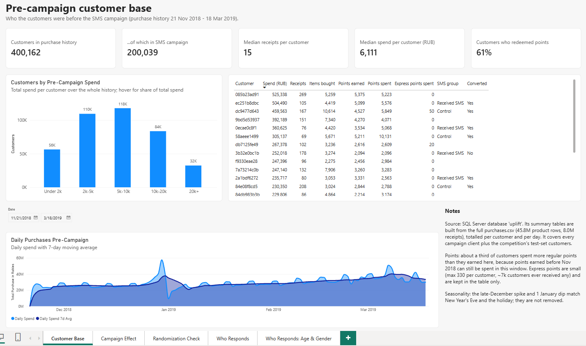
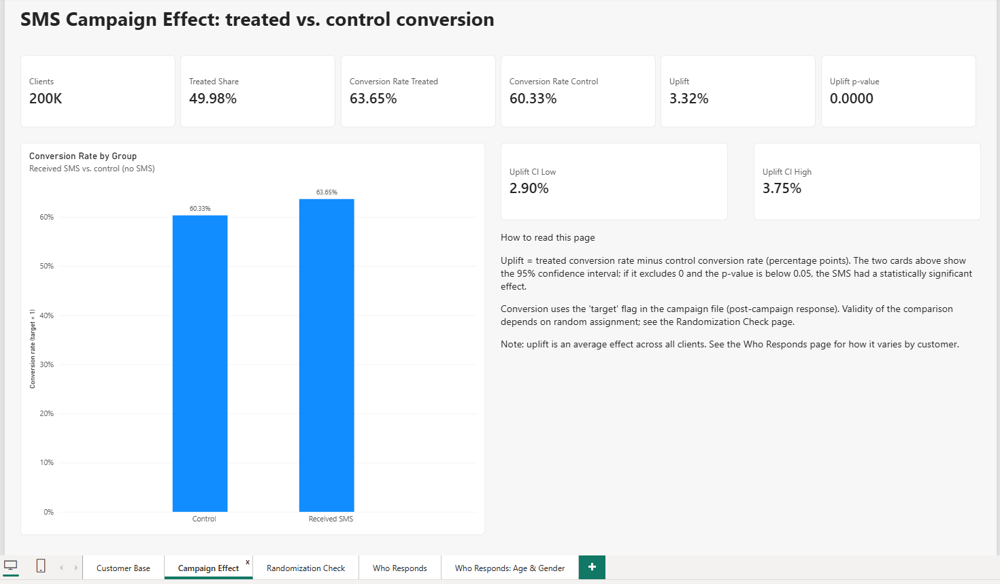
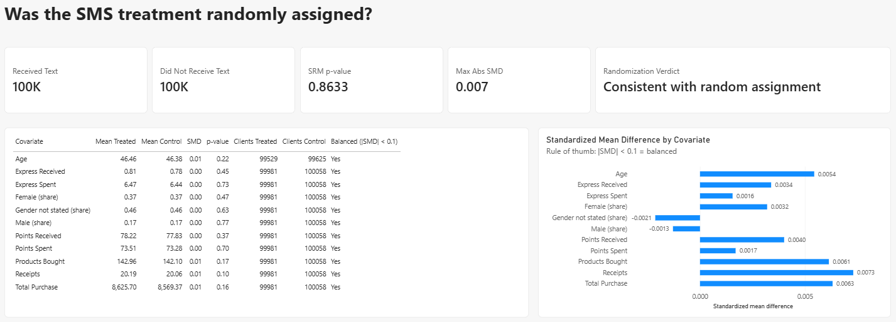
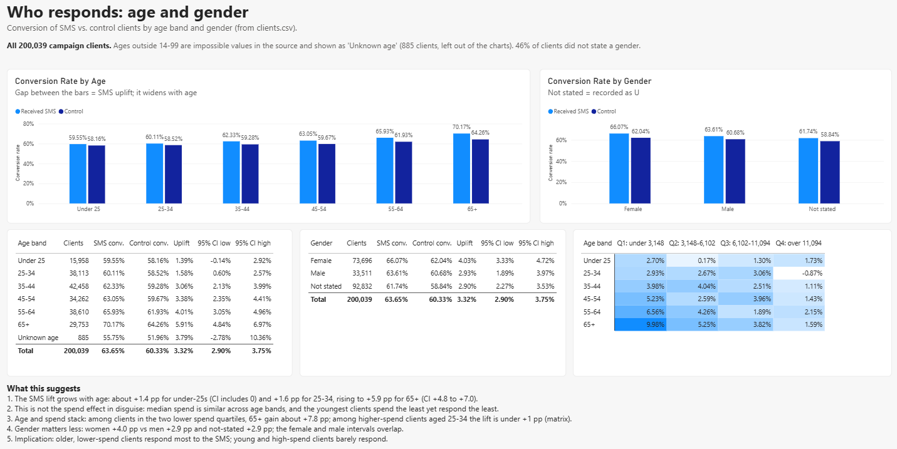
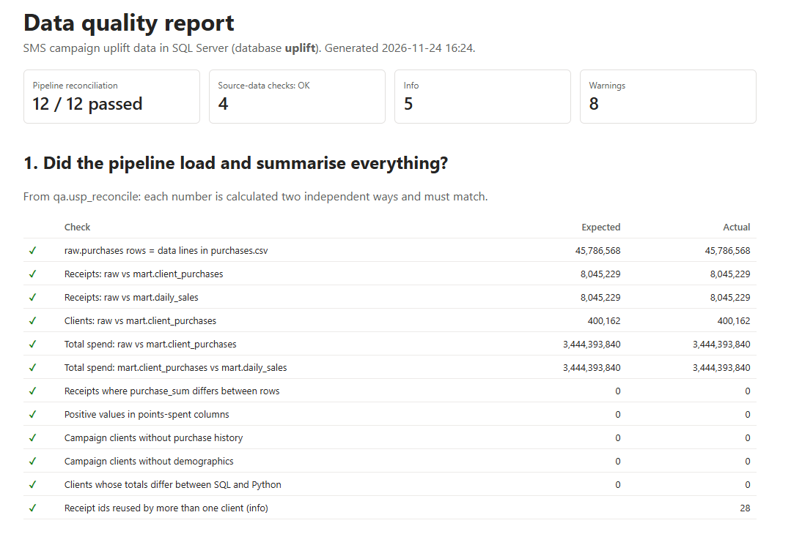
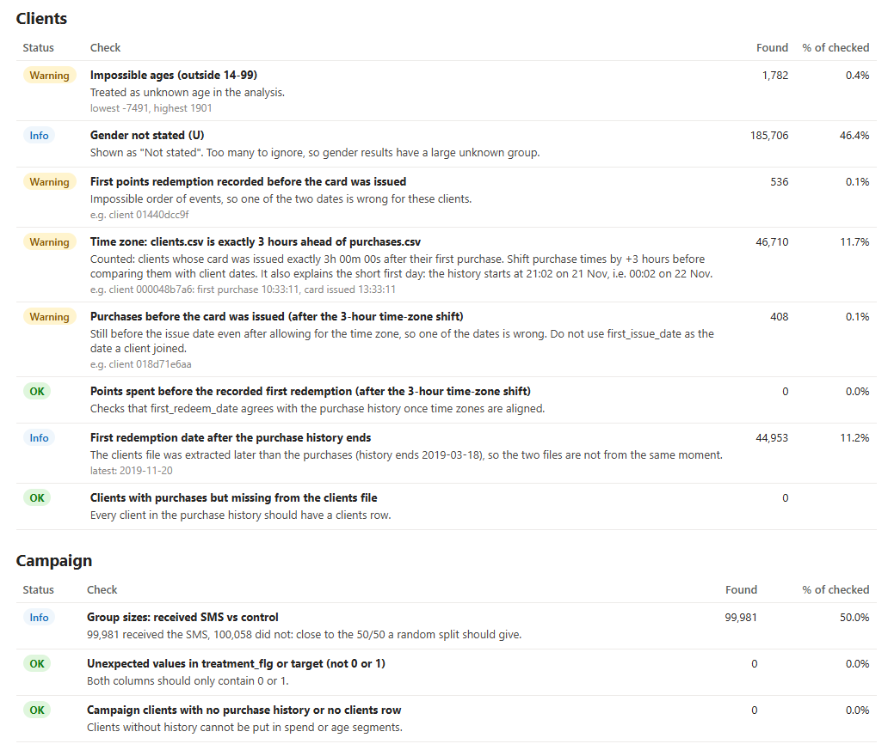

# Who Actually Buys Because of a Text?

A grocery retailer randomly sent promotional SMS messages to 100,000 of its 200,000 loyalty customers. Using uplift modeling, this project estimates the campaign's incremental impact, identifies which customers are most persuadable, and validates the data behind the results.

**Built with:** Power BI (report, DAX, Power Query) · SQL Server (stored procedures) · Python · Docker

## Results

- **The SMS worked.** 63.7% of customers who got the text made a purchase, against 60.3% of those who didn't.
- Customers in the lowest-spend quarter gained the most, **+5.2 points**
- **It worked better on older customers.** About +1.4 points for under-25s (not clearly above zero) up to
  **+5.9 points** for 65+.
- **Recommendation:** if the number of texts is limited or expensive, send them to older, lower-spend customers first. Per
  message, they produce about 5x the extra purchases of top spenders.

---

## The report

### 1. Who the customers were before the campaign

400,162 customers in the purchase history, 200,039 of them in the SMS test. Most spent between 2,000 and 10,000
rubles over the four months. The daily chart shows the New Year's Eve spike and the 1 January dip.

### 2. Did the SMS work?

Conversion was 63.65% with the SMS against 60.33% without. The difference (the "uplift") is 3.32 points, and the
95% confidence interval of 2.90 to 3.75 points does not include zero, so the effect is real rather than luck.

### 3. Was the test fair?

The comparison is only valid if the two groups were alike before the campaign. They were: the group sizes match a
50/50 random split, and the groups have nearly identical spend, receipts, loyalty points, age and gender. The
"standardized mean difference" measures the gap between groups; under 0.1 counts as balanced, and the largest
here is 0.007.

### 4. Who responded?

- **Age:** the lift grows steadily with age, from +1.4 points (under 25) to +5.9 points (65+).
- **Gender:** women +4.0, men +2.9, not stated +2.9. The ranges overlap, so gender matters much less than age.
- **Age and spend together** (heatmap, right): the biggest lift, about +10 points, is among customers aged 65+ in
  the lowest spend quarter.
- **Spend** (separate report page): +5.2 points for the lowest-spend quarter, +3.5, +2.9, then +1.0 for the
  highest. Loyalty-points use made no difference (+3.2 vs +3.4).

### 5. Can the data be trusted? (data quality report)

A separate HTML report, generated from SQL Server, checks the data before anyone relies on the charts.

**Did anything get lost?** Every key number is calculated two independent ways and must match: rows loaded
against lines in the source file, receipts, customers and total spend (to the cent), plus a full comparison
against a separate Python calculation. All 12 checks pass.

**Is the source data sensible?** It flags odd or contradictory data and explains how the analysis handles it.

---

## Problems I found in the data

1. **Two files were recorded in different time zones.** At first, 47,148 customers seemed to buy before receiving
   their loyalty card. The times were exactly 3 hours apart (e.g. purchase 10:33:11, card issued 13:33:11): the
   two files use different time zones. After adjusting, only 408 real conflicts remain.
2. **Items sold by weight have no quantity.** 2.7 million product lines have a quantity of 0 but still have a
   price, most likely goods sold by weight. "Items bought" undercounts them; spend is unaffected.
3. **A filter counted the wrong customers.** In DAX, `treatment_flg = 0` also matches blank values, so 4,573
   customers who weren't in the test were counted in the control group. Fixed with a strict comparison (`==`).

Also handled: impossible ages such as -7,491 and 1,901 (treated as unknown), 46% of customers with no gender
recorded, and a partial first day in the data.

---

## How it's built

**SQL Server** (`sql/`, runs in Docker)
- `01` creates the database and tables. The 45.8M-row purchases table uses columnstore storage (compressed,
  fast to total).
- `02` loads the CSVs with `BULK INSERT`.
- `03` is the core logic: it collapses product rows into receipts, then sums them per customer and per day with
  `GROUP BY`. Views clean the demographics and assign spend quartiles and age bands.
- `04` reconciles the summary tables against the raw data and against an independent Python calculation.
- `05` calculates conversion, uplift and a 95% confidence interval for any customer segment.
- `06` runs the source-data checks behind the data quality report.

**Power BI** (`retail-analytics.pbip`)
- Saved as a Power BI Project, so the semantic model (TMDL) and report pages (JSON) are readable text files.
- Import mode from the SQL Server summary tables. The model has customer-level tables joined one-to-one on
  `client_id`, plus a date table for the daily trend.

**Python**
- `prep_purchases.py` produces the same customer totals with pandas, as an independent cross-check of the SQL.
- `scripts/data_quality_report.py` turns the SQL check results into the HTML data quality report.

## Running it yourself

You don't need to: the screenshots above show everything. If you want to:

1. Download the [X5 RetailHero uplift dataset](https://ods.ai/competitions/x5-retailhero-uplift-modeling) and unzip
   it to `Desktop\uplift`.
2. Create a file named `.env` containing `MSSQL_SA_PASSWORD=` followed by a strong password.
3. With Docker Desktop running and Python installed, run `.\scripts\setup_db.ps1`. This takes about 10 minutes,
   mostly loading the 4.4 GB purchases file.
4. Open `retail-analytics.pbip` in Power BI Desktop. Connect to server `localhost,14333`, database `uplift`.

